<div align="center">



<br>

[**about**](#-about) · [**now**](#-now) · [**stack**](#-stack) · [**stats**](#-stats) · [**contact**](#-ping-me)

</div>

---

## 💻 about

```bash
~/Ragini-telange $ neofetch

  name       →  Ragini Dattatray Telange
  role       →  Computer Engineering Student
  college    →  MIT Academy of Engineering, Alandi, Pune
  year       →  Third Year
  languages  →  C++, Python, JavaScript
  building   →  Web apps, DSA solutions
  status     →  Looking for a software internship
  motto      →  "Ship small. Learn fast."
```

---

## 🚧 now

- 🔨 **Building:** a full-stack web app with React + Node
- 📚 **Learning:** system design, databases, cloud basics
- 🧩 **Practicing:** 2 DSA problems every day
- 🎧 **Fuel:** coffee and lo-fi

---

## 🧪 stack

<details open>
<summary><b>Languages</b></summary>
<br>


</details>

<details open>
<summary><b>Web</b></summary>
<br>


</details>

<details open>
<summary><b>Tools</b></summary>
<br>


</details>

---

## 📊 stats

## 📊 stats

<div align="center">


<br>


</div>
---

## 📡 ping me

<div align="center">

[](https://www.linkedin.com/in/raginitelange/)
[](mailto:raginitelange052@gmail.com)
[](https://leetcode.com/u//)

<br>

```
$ echo "Thanks for stopping by!"
> Thanks for stopping by!
```

</div>
